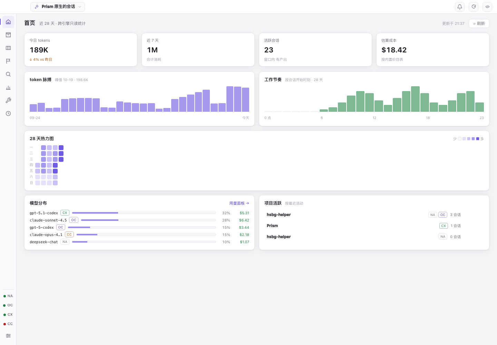
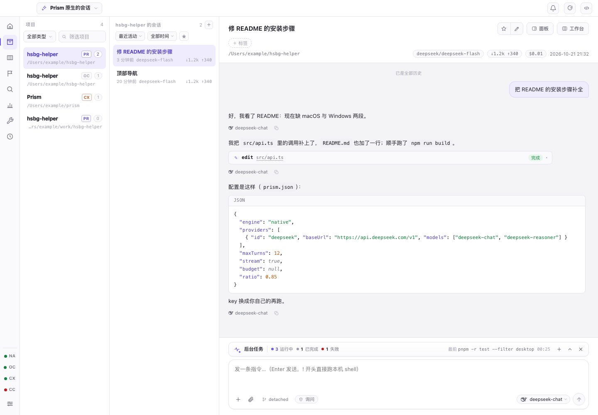
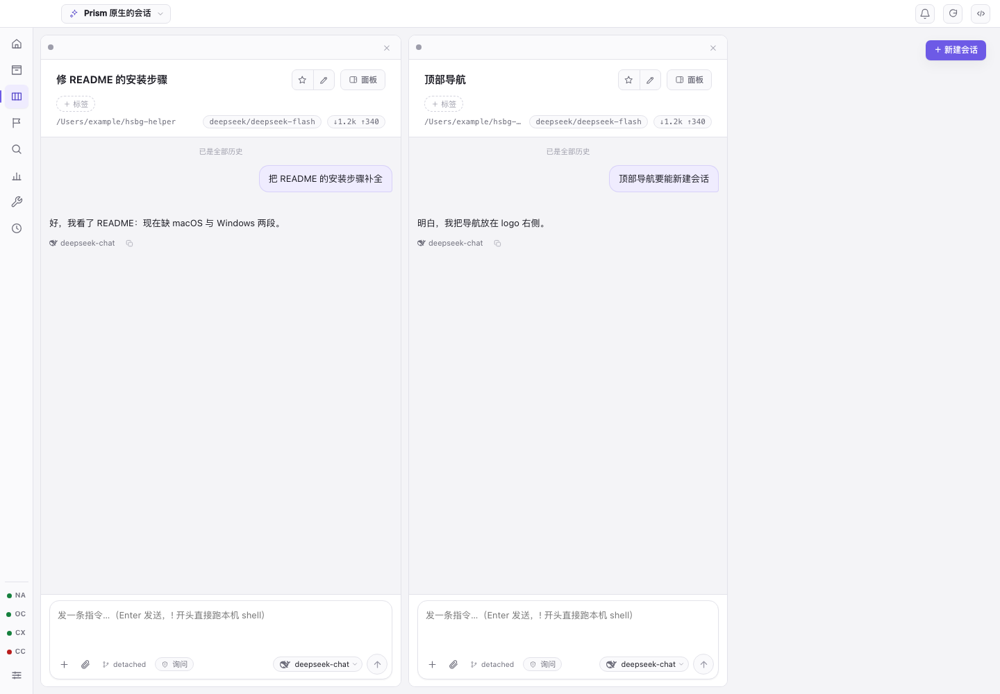
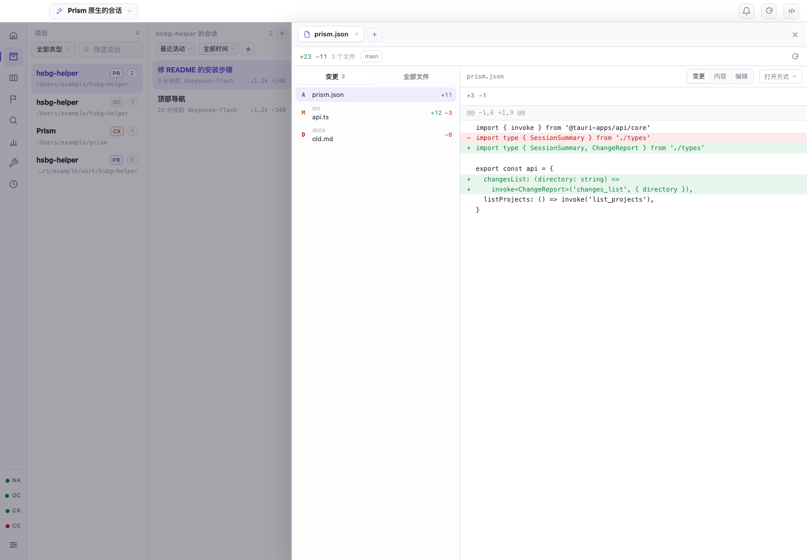
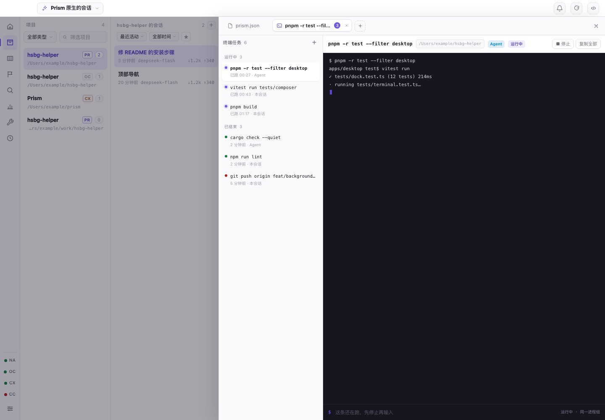
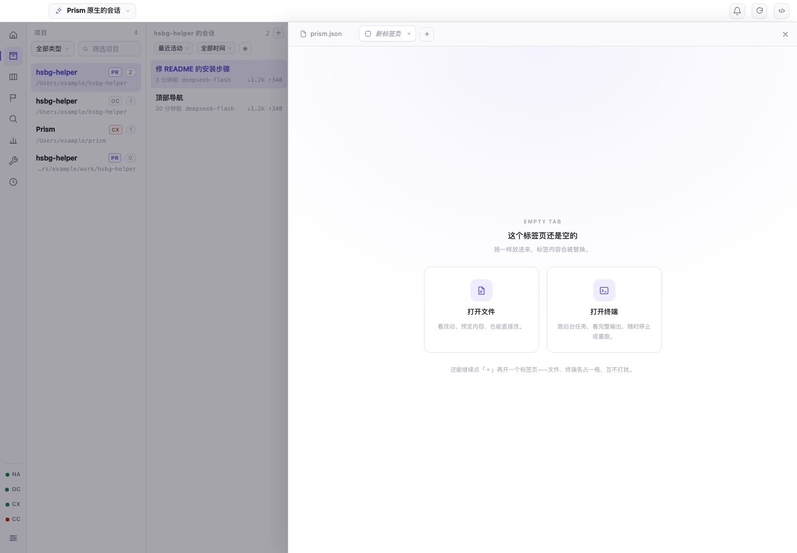
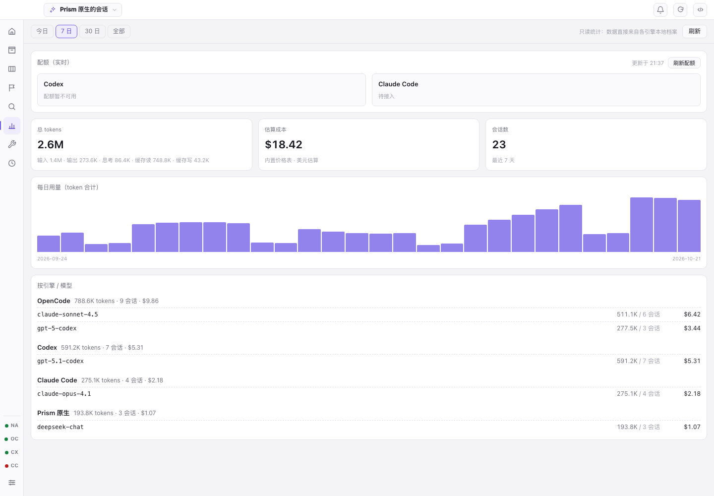

# Prism

多引擎 AI 编码 Agent 指挥台。把 OpenCode / Codex / Claude Code / DeepSeek Harness / 内置 Agent 的会话收进同一面墙：浏览历史、下指令、执行中插话、权限审批，都在一处。

Tauri 2 + Vue 3 + Rust 桌面应用（macOS / Windows x64）。引擎原始数据只读，自有数据只写 `~/.prism/`。



| 归档 | 工作台 |
|---|---|
|  |  |
| **面板**：文件改动 / 终端 / 以后还能开网页 | **终端标签**：完整输出与任务列表 |
|  |  |
| **新标签页**：选打开文件还是终端 | **用量**：跨引擎 token / 成本 / 分布 |
|  |  |

## 功能

- **归档**：项目 / 会话 / 时间线三栏。diff、工具卡完整输入输出、权限卡、LaTeX、沙箱 HTML 都能看；每轮 token 与成本、上下文用量条。
- **工作台**：多列并排盯多个会话，发送 / 插话 / 停止 / 审批都在列内；列宽可拖、布局持久化。
- **面板**：侧边抽屉里开多个标签页（文件 / 终端，以后可加网页）。空标签页选入口，标签可拖动排序、多了横向滚；文件页能看变更 diff、预览、直接编辑保存。
- **后台任务**：`run_command background=true` 立刻返回任务 id，进程进输入框上方的任务坞继续跑；可停止（整组 SIGTERM → SIGKILL）/ 重跑 / 在终端里看。
- **赛马**：同一问题广播给 1–4 个会话同时跑，答案 / 用时 / token / 成本并排对比。
- **搜索**：本地 FTS5 trigram 索引，中文子串即查即中。
- **用量**：跨引擎 token 明细、每日曲线、模型分布、成本估算、Codex 配额实时值。
- **工坊**：四家引擎的技能 / 命令 / 子代理 / 记忆 / 插件只读浏览；MCP 配置列出并探活。
- **自动化**：cron 定时任务，到点用引擎跑提示词，日志可回看会话。
- **托盘**：关窗 ≠ 退出，定时任务与通知继续跑。

## 引擎

| 能力 | OpenCode | Codex | Claude Code | DeepSeek Harness | Prism 原生 |
|---|---|---|---|---|---|
| 历史浏览 | ✅ | ✅ | ✅ | ✅ | ✅ |
| 发消息 / 流式 | ✅ | ✅ | 待本机 CLI | ✅ | ✅ |
| 打断 / 插话 | ✅ | ✅ | — | 打断 ✅ / 插话 — | 打断 ✅ / 插话 — |
| 权限审批 | ✅ | ✅ | — | ✅ | 仅工作目录守卫 |
| 新建会话 | ✅ | ✅ | — | ✅ | ✅ |
| 用量统计 | ✅ | ✅ | ✅ | 会话内 token | 会话内 token |

DeepSeek Harness 走官方 ACP（`dsh --profile acp`，stdio JSON-RPC）：Prism 是「外部控制器」，
不碰它的内部结构；历史直接读 `$DSH_HOME/sessions/**/session.v*.jsonl.zstd`（多帧 zstd，
只读不写）。CLI 与 Prism 共用同一份会话日志，一边聊的回合另一边刷新就能看到。

## 内置 Agent

不依赖本机 CLI，直接用 OpenAI 兼容端点跑自己的 Agent 循环。设置里可挂多个服务（DeepSeek / OpenAI / Ollama 预设），密钥只落 `~/.prism/native/config.json`（0600），界面只回显末四位。

| 工具 | 作用 |
|---|---|
| `read_file` / `list_files` / `grep` | 读文件、列目录、正则搜（都被限制在工作目录内） |
| `write_file` / `edit_file` | 整文件写、按片段替换，同样只允许工作目录内 |
| `run_command` | 跑命令，默认 120s 超时；`background: true` 转后台任务 |
| `task_status` | 查本会话的后台任务 / 看尾部输出 / 停止 |
| `task` | 子代理：隔离上下文跑子任务（`explore` 只读 / `general` 全开），只带回报告 |

权限三档：**只读**（写与命令直接拒）/ **每次询问**（写文件、跑命令弹审批卡）/ **完全访问**。档位按会话记，闸门在 Rust 侧执行。

## 安装

- **macOS（Apple Silicon）**：下载 `Prism_x.y.z_aarch64.dmg`，拖进「应用程序」。未签名，首次打开在访达里 **右键 → 打开**。
- **Windows x64**：下载 `Prism_x.y.z_x64-setup.exe`。未签名，SmartScreen 点「更多信息 → 仍要运行」。

都在 [Releases](https://github.com/MemMori1/Prism/releases)。发版与签名见 [docs/RELEASE.md](docs/RELEASE.md)。

## 开发

```bash
pnpm install
pnpm tauri dev                     # 开发（需要 Rust 工具链）
pnpm test                          # 前端单测（vitest）
cd src-tauri && cargo test --lib   # Rust 单测
scripts/release.sh                 # macOS 发版：构建 + updater 签名 + latest.json
```

Windows 版不在本机构建（macOS 不能交叉编译 Tauri 的 Windows 目标），走 Actions 的 `release-windows` 工作流。

```
src/                 Vue 前端；components/ 一组件一文件，样式在 styles/components/
src/*.ts             纯逻辑模块（nav / diff / markdown / tasks / paneTabs …，多数带单测）
src-tauri/src/       Rust 后端；ipc.rs 命令入口，engines/{opencode,codex,claude,native} 适配器
```

## 已知边界

- macOS 是主力验证平台；Windows 由 CI 出 NSIS 包，两者都未签名 / 公证。Windows 没有进程组，停止只收直接子进程。
- Claude Code 只有历史浏览，运行轴等本机 CLI。
- 搜索索引目前只覆盖 OpenCode 归档。
- 原生 Agent 暂无逐条权限审批（只有目录守卫）、不支持图片输入。
- 定时任务需要 Prism 进程在跑（关窗只是隐藏窗口）。

路线图与里程碑见 [docs/ROADMAP.md](docs/ROADMAP.md)。
